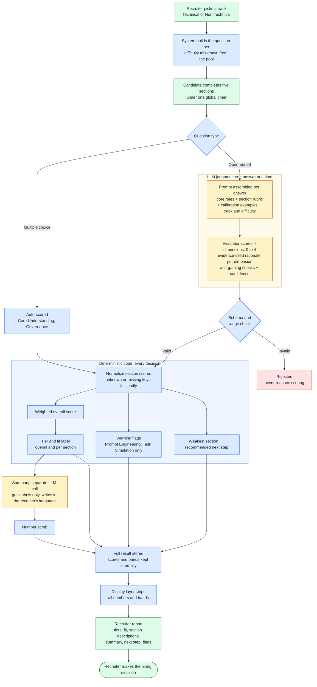

# Evaluation Flow

How a candidate's answers become a recruiter-facing result. The design principle is simple: **the LLM judges individual answers; deterministic code makes every decision; a person makes the hiring call.**

Colors show who acts at each step: amber is the LLM, blue is deterministic code, green is people.

## Who decides what

| Actor | Decides | Never decides |
|---|---|---|
| **LLM evaluator** | How well one answer meets each rubric dimension, with evidence for every score | Section scores, the overall result, tiers or recommendations |
| **LLM summary writer** | Wording of a two-paragraph developmental summary | Anything about the score. It only ever sees labels. |
| **Deterministic code** | Aggregation, tiers, fit labels, warning flags, next step, what reaches the screen | Any judgment about answer quality |
| **Recruiter** | The hiring decision | — |

The product recommends and explains. The recruiter decides.

## Guardrails

| Risk | Guardrail | Origin |
|---|---|---|
| The model rewards length, polish or AI jargon | Explicit bias rules: score content only, ignore grammar and style, jargon is not understanding | Designed |
| Candidates game the scorer | Five anti-gaming checks, such as keyword stuffing and template answers, each with a fixed cap, penalty or flag | Designed |
| Scores drift between runs | Zero-temperature scoring, per-section calibration examples, difficulty-adjusted expectations | Designed |
| Malformed or out-of-range model output | Schema and range check before anything is aggregated | Designed |
| The model computes its own aggregate score | Scope rule forbidding aggregates, plus aggregation done in code only | Found in QA, fixed |
| Section-name mismatches silently score as zero | Score names normalized, and unknown or missing sections fail loudly | Found in QA, fixed |
| Summary written in the candidate's language, not the recruiter's | Output language passed explicitly | Found in QA, fixed |
| Numbers leak into recruiter-facing text | Summary gets labels only, a number scrub on its output, and the display layer strips scores and bands | Designed, and hardened after QA |

## When the AI is wrong

Any error is contained to a single answer. The model never sees the full assessment, so one bad judgment moves one section score, not the verdict. Every score carries an evidence-cited rationale and a confidence level, so it can be inspected after the fact.

One limit is worth stating plainly:

- **No live AI in the test.** Candidates write about how they'd work with AI rather than doing it live, so iterative reasoning is not scored. See decision 6 in the [decision log](decision-log.md).

---

*Scoring weights, tier thresholds and prompt text are withheld. The flow is accurate to the production evaluator; implementation details are abstracted.*
