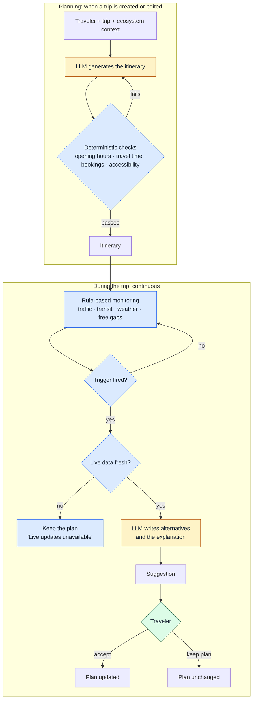

# The TripWise Decision Model

**When the engine speaks up, how it explains itself, what it must never do, and how it stays reliable and affordable.**

## Two loops, two kinds of logic

Amber is the LLM, blue is deterministic logic, green is the traveler. The LLM runs **only when it adds value**: when a trip is generated or edited, and when a trigger has actually fired. Watching the trip is cheap rule checks against live data.

## When the engine speaks up

| Trigger | Fires when | Priority |
|---|---|---|
| **Transport disruption** | A delay or cancellation hits a booked leg | Immediate, highest |
| **Traffic** | The delay puts the next *fixed* item at risk (a booked slot or ticket time), or adds more than a set threshold | High. Minor slowdowns stay silent. |
| **Weather** | The forecast changes during an *outdoor* activity's time window | Medium. Swap indoor or reorder the day. |
| **Opportunity** | A relevant experience or pick fits a free gap in the plan | Low. Free time only, capped per day. |

The tiers exist to protect attention. An assistant that pings about every five-minute slowdown trains people to ignore it.

## How a suggestion explains itself

Every suggestion has the same four parts: **cause → impact on your plan → option → what you keep.**

> **Rain from 14:00** · Your Old Town walk is outdoors · Swap with the Maritime Museum (indoor, 12 min away) · Dinner booking unchanged

The traveler sees *why* before *what*, so accepting is an informed choice, not blind trust in the AI. Nothing is applied until they accept.

## What the engine must never do

- **Never modify a paid booking.** Bookings are fixed anchors, and the rest of the day reflows around them. If a booking itself is at risk, the provider's change or cancellation policy is shown before any suggestion.
- **Never sneak in a partner offer.** Partner offers are always labelled, appear only when they match the traveler's profile, and never silently replace something the traveler chose.

## Generation rules

- **No impossible days.** Before an itinerary is shown, deterministic checks validate opening hours, travel time between stops and booked times. A plan that fails a check is never shown as it is.
- **Hard constraints versus preferences.** Accessibility needs (for example, step-free routes and venues) are *hard constraints* the plan must satisfy. Mood, interests and pace are *soft preferences*: a "relaxed" mood means fewer stops per day, not different rules.

## When data is missing

If a live feed is unavailable or out of date, the plan stays as it is, and the app shows **"Live updates unavailable"** with the time of the last update. A confident suggestion based on stale traffic data is worse than no suggestion.

## Two worked scenarios

**Traffic before a booked slot**
1. A museum entry is booked for 15:00. Traffic adds 25 minutes to the route.
2. The traffic trigger fires because a fixed item is at risk, and the data is fresh.
3. The LLM writes the options: a faster route, or leaving 20 minutes earlier and skipping a coffee stop.
4. *Traffic on your route · You'd miss your 15:00 entry · Leave at 14:10 via the ring road · Museum booking kept.*
5. The traveler accepts, and the plan updates. If they choose "Keep my plan," nothing changes.

**Weather on an outdoor afternoon**
1. The forecast changes to rain from 14:00, overlapping a planned harbour walk.
2. The weather trigger fires because the activity is outdoors and inside the rain window.
3. Options are generated within the traveler's constraints: an indoor venue nearby, step-free if their profile requires it.
4. *Rain from 14:00 · Your harbour walk is outdoors · Swap with the Maritime Museum, 12 min away · Dinner booking unchanged.*
5. The traveler decides.

---

*The triggers, explanation format, guardrails, generation rules and fallbacks above are confirmed. Thresholds are described generally, and the scenarios use synthetic data.*
