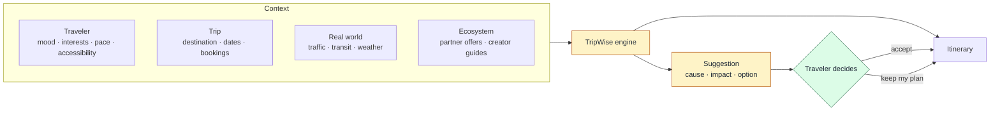

# TripWise

**An AI travel platform where AI is the engine behind the whole trip, not a chatbot on top of it, and where the traveler always makes the final call.**

**Role:** Product Manager / Product Builder (from concept to handoff)
**Stage:** Functional prototype, ready for MVP development handoff
**Focus:** AI product strategy · Real-time decision support · Human-in-the-loop design · Multi-sided ecosystem · End-to-end product design · AI-built prototyping

---

## The problem

Travelers bounce between a dozen tools: inspiration, itinerary planners, maps, weather, transport, hotel booking, attraction tickets, social apps. Even the best itinerary goes stale the moment real life happens: traffic, a cancelled train, rain on the afternoon you planned to walk.

Most AI travel products answer *"where should I go?"* TripWise was built around a harder question:

> **Understand the traveler, the trip and the conditions on the ground, and keep helping them make better decisions throughout the journey.**

## How it works

The engine plans the trip, watches for disruptions and opportunities, and *suggests* changes. Nothing changes until the traveler accepts.

## My role

I took TripWise from concept to a functional prototype, owning both the product and the design:

- **Strategy:** vision, positioning, market and competitor research (including TripIt and Wanderlog), personas, ecosystem design, the monetization path.
- **Definition:** product architecture, MVP scope, prioritization, PRDs, user stories, business rules, edge cases, AI product requirements, technical constraints.
- **Design:** UX research, information architecture, user flows, wireframes, high-fidelity UI, the design system, interaction and responsive design.
- **Prototype:** built first with Figma Make (Figma's AI), then as a vibe-coded functional prototype.

I didn't build the AI models, the routing, or the booking and backend integrations.

## Key decisions

1. **AI as the engine, not a chatbot.** Intelligence is spread across planning, monitoring and suggestions, not hidden behind a chat box.
2. **Suggest, never silently change.** Every change is explained (*cause → impact → option → what you keep*) and needs the traveler's approval.
3. **Alerts tiered by urgency.** A booked leg disrupted is an immediate alert. Traffic only matters if it threatens a fixed commitment. Weather only matters for outdoor plans. Opportunities wait for free time, with a daily limit.
4. **Bookings are fixed anchors.** The engine never modifies a paid booking; the day reflows around bookings.
5. **Validate before you show.** Deterministic checks on opening hours, travel times and bookings mean the AI can't produce an impossible day. Accessibility is a hard constraint; mood is a preference.
6. **Fail safe, and use AI only where it adds value.** Stale data means no suggestion. Cheap rules watch the trip, and the LLM is called only to write alternatives when something actually happens.
7. **A narrow MVP, a fully defined vision.** The MVP is the itinerary plus flight and hotel booking. Everything else was defined and prototyped to show its dependencies up front.

## Outcome

- Taken from concept to a functional prototype ready for MVP development.
- Defined and designed experiences for travelers, partners and creators, with a design system across them.
- A clear MVP boundary and phased roadmap.

The product wasn't launched during my involvement.

## Explore

- [`Docs/01-ai-as-the-engine.md`](Docs/01-ai-as-the-engine.md): from concept to prototype, the ecosystem, MVP scope, and how the prototype was built with AI tools.
- [`Docs/decision-model.md`](Docs/decision-model.md): triggers, explanations, guardrails, fallbacks and cost, with two worked scenarios.
- [`Docs/decision-log.md`](Docs/decision-log.md): ten product decisions, with their context and trade-offs.
- Prototype: the [traveler app](https://mebi-kell.github.io/product-management-portfolio/AI%20Travel%20Itinerary%20%28Tripwise%29/Prototype/TripWise%20App%20v2.dc.html) and [TripWise Studio](https://mebi-kell.github.io/product-management-portfolio/AI%20Travel%20Itinerary%20%28Tripwise%29/Prototype/TripWise%20Studio.dc.html), the admin panel for partners and creators. Both are portfolio reconstructions with synthetic data.

---

*All data and examples are synthetic. Spotify and Apple Music were planned integrations, not built ones.*
