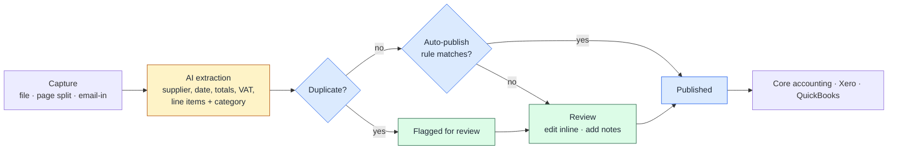

# Designing an Accounting Ecosystem

**How three related products got distinct jobs, how an AI document-capture product was designed to keep people in control, and what it took to prepare it for beta.**

## Context

The products served accounting and bookkeeping firms. There was no dedicated PM for most of my involvement. As Product Management Assistant, I worked across research, architecture, workflows, UX requirements, the AI document flow and beta preparation. Later I moved into product marketing. A dedicated PM took over after the MVP.

## Starting with the market

I researched established products, including **Xero** and **Dext**, along with QuickBooks. The research covered:

- accounting workflows and how firms actually move work through them
- document capture and automation
- UX patterns, information hierarchy and where existing tools create friction
- packaging and pricing: what gets monetized, and in which plans
- positioning and target customers

It was used to make decisions, not to list features. The questions it answered:

- **Table stakes:** what does a firm expect from day one?
- **Gaps:** where do workflows break or go missing?
- **Differentiation:** where is there room to stand out?
- **Focus:** who is the primary user?

## Drawing the boundaries

The hardest product question wasn't a feature. It was **what belongs where**:

| Product | Its job | Not its job |
|---|---|---|
| **Core accounting** | The financial workflow: categorize, reconcile, bookkeep, report | Running the firm |
| **Practice management** | Running the firm: clients, work, deadlines, tickets, client communication | The ledger |
| **Document capture** | Turning paper into structured, bookkeeping-ready data | Being an accounting system |

Every product has its own sign-up, company settings and team management, so each can be adopted on its own, and none forces a firm to switch everything at once.

The full breakdown is in the [boundary map](boundary-map.md).

## Document capture: AI with a configurable human checkpoint

I worked on every step of this flow: extraction, review, duplicate detection, categorization and auto-publish rules.

*Conceptual flow.* Amber is AI, blue is deterministic logic, green is people.

**Capture.** Documents arrive through several channels:
- individual upload, either one document per file or one per page, so a multi-page scan can be split into separate documents
- an email-in address
- bank connections and statement upload, alongside the documents

**Extraction.** The AI reads general data (supplier, date, document number), then amounts and VAT, and then individual line items, each with a category. Cost documents and sales documents are handled separately, with supplier records built up over time.

**Duplicate detection.** The same receipt can arrive twice, for example by email and by upload. Duplicate recognition catches it, and in the flow above a suspected duplicate goes to review instead of publishing.

**Review.** Extracted data is edited inline, line by line: items, amounts, VAT and category. Every document keeps notes and its own activity log, so you can always see who changed what.

**Auto-publish rules.** This is the key design choice. Reviewing every document doesn't scale, and auto-publishing everything isn't something a firm can trust. Rules let the firm decide which documents may skip review.

*Illustrative rule conditions, reconstructed:*
- a known supplier with an established category
- line items that add up to the total, with VAT consistent with the net amount
- no duplicate flag
- an amount below a threshold the firm sets

Anything that fails a condition goes to a person. Automation scales with the firm's trust instead of being all or nothing.

**Output.** Published data goes to the core accounting platform or, as a standalone product, to **Xero** (ready) or **QuickBooks** (in progress). Extracted data can also be exported, and there's a dashboard with an expense and revenue summary.

## Practice management: built around the client

Practice management is organized around a single client record that holds everything:

- contacts, tasks, tickets, documents, emails and filings
- notes, tags and an activity log

Around that:

- **Onboarding clients:** add manually, import from the UK company register, send an onboarding link, or bulk upload. A rule engine to pick up company-register updates automatically was in QA.
- **Work:** predefined and custom projects, task templates, one level of sub-tasks, stage configuration, and a rule engine for task automation.
- **Communication:** tickets with departments and email routing, a client portal (invite, tickets, documents, dashboard), and a calendar with Google sync.
- **Growth:** a CRM pipeline with win and loss scenarios.
- **Compliance:** a tax-authority (HMRC) integration.

## Getting to beta

Beta preparation brought real constraints:

- **QA started late.** The QA resource joined later than planned and was shared with events and demos for another project. Integrations like Xero needed thorough testing before beta, so dedicated QA support was flagged as a requirement.
- **Template-built screens.** Some early screens were built directly from a template or prototype without a dedicated UX review, and the delivery tracker said so explicitly.
- **No mobile developer.** Real-time receipt upload stayed in progress, while in-app mobile editing and expense claims were postponed.
- **Scope held for later.** Reporting, the help center and client groups were still at concept stage during beta preparation, so they weren't part of the beta scope.

## Product to market

Later I moved into product marketing for the core accounting and document-capture products. The work was translation: *product capability → user problem → customer value → differentiator → message → website, demo and sales material.* It covered positioning, value proposition, messaging and differentiators, ICP and persona framing, website structure and copy, demo narrative, and which capabilities to emphasize.

## Outcome

- MVP reached, and beta prepared for practice management and document capture.
- **Practice management:** 56 of 76 tracked functions fully ready.
- **Document capture:** 34 of 54 fully ready, with a working Xero integration.
- A clear three-product architecture, which the dedicated PM inherited after the MVP.

## What I learned

- **Boundaries are a product decision.** Three products serving one firm can easily blur into one product trying to do everything. Giving each a single job (financial work, practice work, paperwork) means "does this belong here?" always has an answer.
- **The standalone option is a strategy, not a side feature.** Exporting to Xero means selling to firms that would never switch their accounting platform. That one integration turned document capture from a feature of our suite into a product in its own right.
- **In document AI, trust is the product.** Extraction gets attention, but the auto-publish rules are what make it usable at scale. They let a firm start with everything reviewed and gradually trust automation on the documents it understands, like known suppliers and totals that add up.
- **Check the arithmetic before you trust the model.** Line items should add up to the total, and VAT should match the net amount. Simple deterministic checks catch many extraction errors before a person has to.
- **Beta readiness is about resources as much as features.** Late QA, shared testers and no mobile developer shaped the beta as much as any feature list. Being explicit about what was postponed kept the beta honest.
