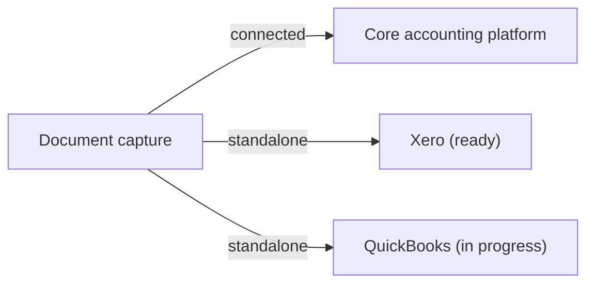

# Product Boundary Map

**Which job belongs to which product, and where the products connect.**

● owns the job · ○ receives from or connects to it

| Job | Document capture | Core accounting | Practice management |
|---|:---:|:---:|:---:|
| Capture receipts and invoices (upload, page split, email-in) | ● | | |
| Extract supplier, totals, VAT, line items | ● | | |
| Categorize line items | ● | ○ | |
| Detect duplicates | ● | | |
| Review and auto-publish | ● | ○ | |
| Bank connections and transactions | ● | ○ | |
| Reconcile and bookkeep | | ● | |
| Financial reporting | ○ | ● | |
| Onboard clients (manual, company register, onboarding link, bulk) | | | ● |
| Client record: contacts, documents, emails, filings, notes | | ○ | ● |
| Projects, tasks, templates, task automation | | | ● |
| Tickets and the client portal | | | ● |
| Deadlines and calendar | | | ● |
| CRM pipeline | | | ● |
| Tax-authority integration | | ○ | ● |
| Sign-up, company and team management | ● | ● | ● |

## Where the boundaries mattered

- **Document capture stops at "published."** It produces trustworthy structured data and hands it off. It doesn't do bookkeeping, which is what lets it publish to Xero or QuickBooks just as easily as to the core platform.
- **Practice management owns the client, not the ledger.** Everything about *serving* a client lives in the client record. Everything about the client's *numbers* lives in accounting.
- **Each product has its own front door.** Each has its own sign-up, company and team management, so a firm can adopt any one of them first.

## Standalone vs. connected

Connected, it feeds the ecosystem. Standalone, it sells to firms that are already committed to another accounting platform.

---

*Conceptual product boundaries. They don't describe the internal architecture.*
