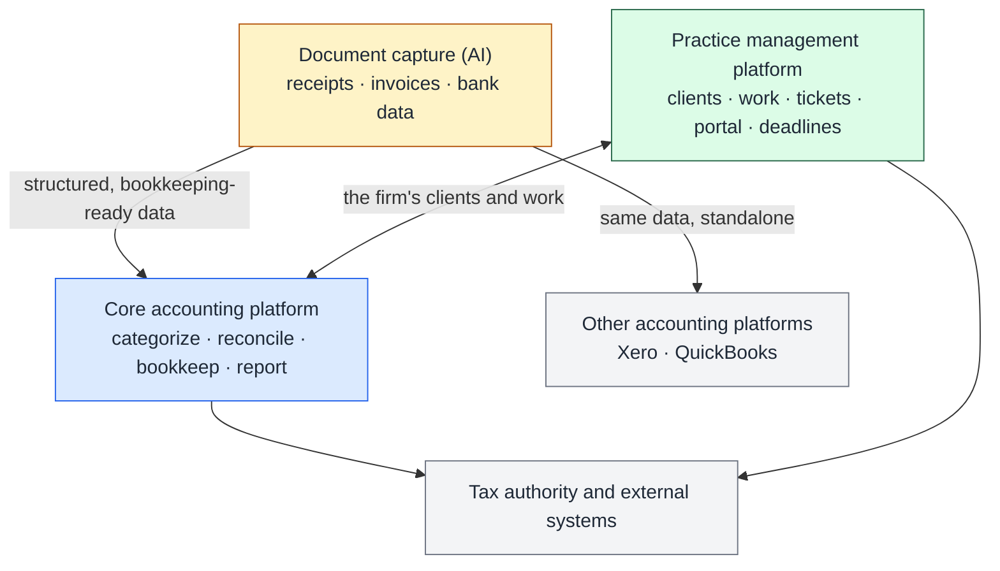

# Accounting Product Ecosystem

**Three connected products for accounting and bookkeeping firms: deciding what each one owns, and building an AI document-capture product that works with or without the rest.**

**Formal title:** Product Management Assistant (no dedicated PM for most of my involvement)
**Actual scope:** market and competitive research, product architecture, workflow definition, feature prioritization, user flows and UX requirements, design review, AI extraction and review flow, beta preparation, product marketing
**Stage:** MVP reached and beta prepared during my involvement. A dedicated PM took over afterwards.
**Focus:** Ecosystem architecture · Product boundaries · AI document extraction with human review · Product-to-market

---

## The problem

An accounting firm's day touches three different kinds of work:

- **Financial work:** categorizing, reconciling, bookkeeping, reporting.
- **Practice work:** onboarding clients, chasing deadlines, assigning tasks, answering tickets.
- **Paperwork:** receipts and invoices that someone has to type in.

Most firms combine separate tools for each. The opportunity was an ecosystem that covers all three without becoming one bloated product.

## The ecosystem

*Conceptual. Each product has its own sign-up, company and team management, so each can be adopted on its own.*

## My role

There was no dedicated PM for most of my involvement:

- **Research:** market and competitive research, including Xero and Dext, into workflows, document capture, automation, UX patterns, packaging and pricing.
- **Architecture:** helped decide which capabilities belong in which product, and which should stand alone.
- **Definition:** workflows, missing-workflow identification, feature priorities, user flows and UX requirements; design review.
- **AI document flow:** worked across extraction, the review step, duplicate detection, categorization and the auto-publish rules.
- **Beta preparation** for the practice-management and document-capture products.
- **Product marketing** for the core and document-capture products: positioning, messaging, differentiators, website direction and copy, and demo narrative.

## Key decisions

1. **Three products, not one.** Accounting, practice operations and document capture each got a distinct job and value proposition.
2. **Document capture can stand alone.** It exports to Xero (ready) and QuickBooks (in progress), so it can serve firms that will never switch accounting platforms.
3. **AI extracts, people review, and rules decide when review can be skipped.** Auto-publish rules make the human checkpoint something the firm configures, not something hard-coded.
4. **Practice management is built around the client record.** Contacts, tasks, tickets, documents, emails, filings and notes all hang off one client.
5. **Postpone what the team can't resource yet.** With no mobile developer available, in-app mobile editing and expense claims were postponed, while real-time receipt upload stayed in progress.

## Outcome

- MVP reached across the practice-management and document-capture products, and beta prepared.
- **Practice management:** 76 tracked functions, 56 fully ready, including client onboarding, projects and tasks with automation, tickets, CRM, a client portal and a tax-authority integration.
- **Document capture:** 54 tracked functions, 34 fully ready, including multi-channel upload, AI extraction down to line items and VAT, duplicate detection, bank connections, automation rules and a Xero integration.

## Explore

- [`Docs/01-designing-an-accounting-ecosystem.md`](Docs/01-designing-an-accounting-ecosystem.md): boundaries, the AI extraction and review flow, delivery constraints, and the product-to-market work.
- [`Docs/boundary-map.md`](Docs/boundary-map.md): which job belongs to which product, and where they connect.
- [`Prototype`](https://mebi-kell.github.io/product-management-portfolio/Accounting%20Product%20Ecosystem/Prototype/Ledra%20Capture%20v2.dc.html): an interactive walkthrough of the document-capture product. It is a portfolio reconstruction with synthetic data.

---

*Company, product and individual names are omitted. Diagrams are conceptual. Competitor names refer to public products.*
