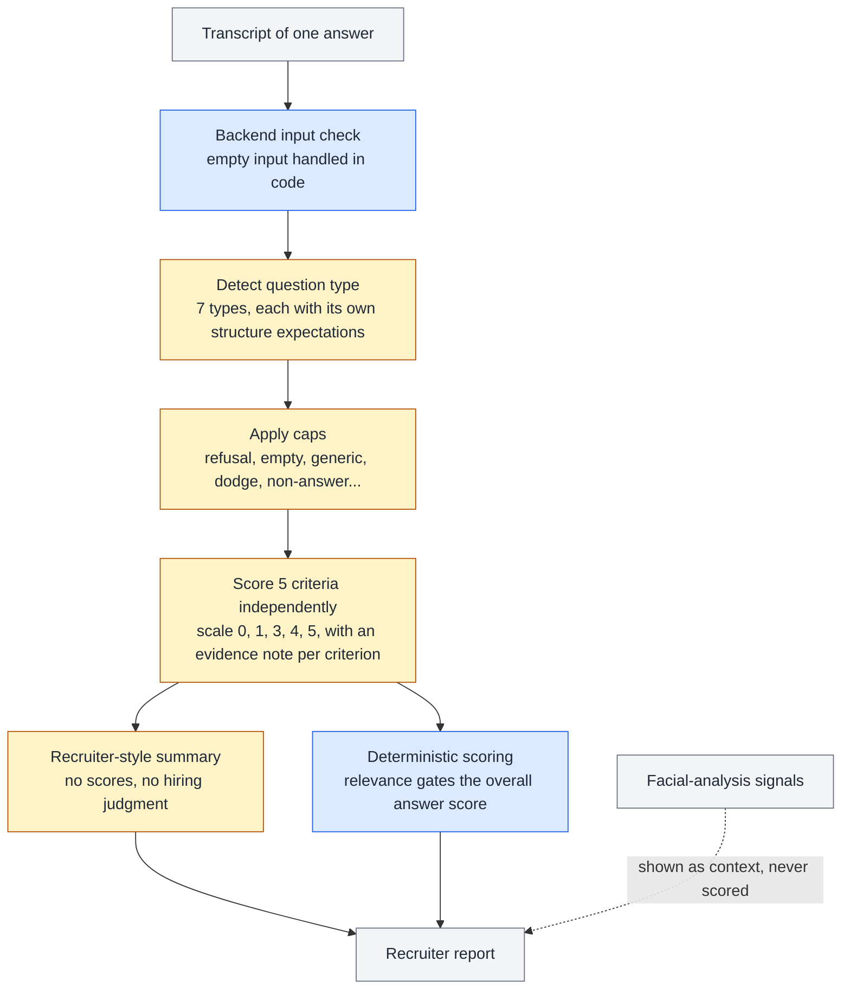

# Calibrating an LLM Interview Scorer

**How pre-launch testing, not the original rubric draft, shaped the evaluator that shipped, so Beta candidates were scored by a calibrated version from day one.**

## Context

Candidates record spoken answers. Each answer is transcribed, then an LLM scores the transcript against a rubric with five criteria: relevance, specificity, clarity, structure and depth. Recruiters see per-criterion scores, short evidence notes, and a summary.

I wrote the evaluation system, which went through many versions before the one that shipped. Engineering integrated the final version as written.

## The problem

A rubric is a hypothesis about what good looks like. Testing it before launch exposed several failure patterns that a draft rubric doesn't anticipate:

- Strong answers scored too low.
- Scores leaked from one question into the next.
- Relevance was handed out too generously.
- Fluent non-answers scored as if they were real answers.
- Summaries described weak answers as "placeholder text."

None of these were crashes. Each one quietly made candidates less comparable, which defeats the purpose of structured evaluation. All of them were resolved before Beta.

## Constraints

- **The input is speech, not writing.** Transcripts contain filler words, false starts and accents, and speech-to-text also cleans them up unevenly.
- **Questions vary by type.** "Tell me about yourself" and "Explain how X works" need different structural expectations.
- **The product is multilingual.** Candidates may answer in a different language from the job posting.
- **Every call has a cost and a size limit.** The prompt can't grow forever.

## What I found and changed

| Symptom | Diagnosis | Change |
|---|---|---|
| Strong answers clustered low | The mid-level definition was framed negatively. More fundamentally, the 0-1-3-5 scale had no value that mapped to the "strong" label recruiters saw. | Reframed the definitions and moved to a 0-1-3-4-5 scale. The prompt states the expected spread: mostly 3s and 4s, with occasional 1s and 5s. |
| Earlier answers influenced later scores | Evaluation wasn't fully independent | Every answer is scored independently, with no memory of earlier answers or scores. |
| All five criteria scored the same (halo effect) | One strong impression carried across criteria | Criteria are scored in a fixed order with judgment reset at each step. Identical scores trigger re-examination. |
| Relevance often scored at the top level | "Mentions the topic" was being treated as "answers the question" | Top relevance now requires a complete, direct answer. When expected points exist, the share of points covered sets ceilings on relevance and depth. |
| Fluent non-answers scored well | Nothing stopped a fluent answer from passing on polish alone | Caps applied before scoring: refusal, empty, too short, generic, dodge, non-answer, insufficient data. The most restrictive cap wins. |
| Summaries called weak answers "placeholder text" | The model confused a poor answer with missing input | Summaries must describe what the candidate actually did. A filler-heavy answer is still a real answer. |
| A "missing input" check misfired on genuine answers | The template engine filled in the placeholders before the model ran, so the in-prompt check could never work | Removed the check from the prompt; empty input is now validated in backend code. |
| Recurring API errors | The prompt had grown to about 3,500 words | Rebuilt it at about 1,200 words (66% smaller) with every rule kept. |

## How a single answer is evaluated

Amber steps are the LLM. Blue steps are deterministic code.

## Three design principles behind the changes

**Judge speech as speech.** Filler words, accents and grammar aren't penalized unless meaning is lost. A clean transcript counts as baseline clarity, not exceptional clarity, so speech-to-text cleanup can't inflate scores. Confident delivery never substitutes for reasoning.

**Relevance gates everything.** In the scoring code, relevance has an outsized effect on the answer score, and low-relevance answers are capped however polished they are. A rough answer to the right question should beat a fluent answer to a different one.

**Not every signal should become a score.** Facial-analysis signals are shown to recruiters as context only. Emotional expression is noisy, depends on context and varies across cultures. It doesn't belong in a hiring score.

## Language handling

Evidence notes are written in the candidate's language, so they quote faithfully. Summaries are written in the job's language, so the recruiter can read them. Separating the two was necessary because candidates don't always answer in the language of the job posting.

## Validation

- **Score distributions across test answers.** These were the first signal that the scale and the UI labels disagreed, and the main check that the fix worked.
- **Explicit edge-case testing:** refusals, empty transcripts, filler-only answers, gibberish and generic answers.
- **Summary output reviewed** for mislabeling and for anything that read like a hiring verdict.

## Outcome

- The final evaluator shipped as written and scored answers for more than 4,360 candidates during Beta.
- Under load testing, AI processing succeeded more than 99.5% of the time, and reports were generated in under 30 seconds.
- The prompt is 66% smaller than its peak and has one place for each rule.

## What I learned

- **Check the instrument before tuning the rules.** The biggest scoring problem wasn't the wording of any criterion. It was a scale that couldn't express what the UI promised.
- **Prompts are the wrong place for input validation.** Anything that depends on how a template is filled in belongs in code.
- **A rubric needs a reference set from day one.** Calibrating against human-rated answers earlier would have turned "looks right" into a measurable agreement score.
