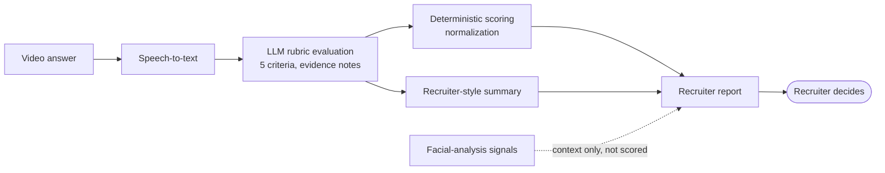

# Async AI Video Interview

**Turning recorded interview answers into structured, explainable hiring signals, and fitting that into an enterprise assessment platform.**

**Role:** Product Manager / Product Owner
**Stage:** Shipped. More than 4,360 candidates interviewed during Beta.
**Focus:** AI evaluation design · Systems and integration thinking · UX · QA · Delivery

---

## The problem

First-round interviews don't scale. Recruiters coordinate calendars, ask the same questions repeatedly, and then rewatch hours of video to compare candidates who were each judged a little differently.

Async video solves the scheduling half. The harder half is review. A pile of recordings is just a slower version of the same problem unless something turns it into evidence a recruiter can compare.

## What it is

Recruiters build an interview of up to 10 questions. Each question comes from a ready-made catalogue, is written by the recruiter with optional sub-questions, or is reused from a company template. The recruiter sets thinking time, answer time and retries, brands the experience, and invites candidates.

Candidates complete the interview in a browser on their own schedule:

1. Consent
2. Camera and microphone check
3. Optional practice round
4. Answer each question
5. Review and submit

Each answer is transcribed, then scored by an LLM against a five-criterion rubric. Code normalizes those scores into an answer-quality result. Recruiters get a report showing each recording, its transcript, per-criterion scores with short evidence notes, and an AI summary, exportable in two languages.

## My role

The team had no dedicated designer, QA function or Scrum Master. I owned product and covered those gaps.

- **Product.** I turned customer requests and business needs into requirements, workflows, acceptance criteria and edge cases, then broke them down into engineering tasks.
- **Evaluation design.** I wrote the scoring system myself: the rubric, the evaluator prompt across versions up to the shipped one, and the scoring logic. Engineering integrated the final version as written.
- **Product design.** I owned the recruiter and candidate UX, using AI design tools alongside my own UX judgment.
- **Integration.** I defined how the interview engine fits into the wider assessment platform: which system owns which responsibility, the synchronized statuses, and the failure handling.
- **QA and delivery.** I tested implementations, investigated likely root causes, proposed technical resolution options to engineers, and kept scope and priorities clear.

## Key decisions

The reasoning and trade-offs for each are in the [decision log](Docs/decision-log.md).

1. **A rubric, not a rating.** The LLM evaluates five separate criteria with evidence. It is never asked to "rate this candidate."
2. **The scale was fixed before launch.** In pre-launch testing, strong answers were scoring too low. I traced it to a gap between the scoring scale and the labels in the UI, and changed the scale.
3. **Speech is judged as speech.** Filler words, accents and grammar aren't penalized, and machine-cleaned transcripts aren't rewarded for polish.
4. **Relevance gates everything.** A fluent answer that doesn't address the question can't score well.
5. **Not every AI signal should become a score.** Facial-analysis output is shown as context and never feeds the result.
6. **Request vs. product model.** "We need our own question catalogue" led to adding ownership and visibility scopes to the catalogue, governed by admins, not to a one-off build for that customer.
7. **Each system owns its domain.** The platform owns the assessment lifecycle; the interview engine owns the interview and the AI processing. The split follows each system's architecture, not preference. Interview creation is retry-safe, so a failure can't leave half-built interviews or duplicate sessions.

## How AI was part of my workflow

I iterated the evaluator with AI assistants across many versions. Each version was a hypothesis tested in pre-launch testing: why scores bunched, why relevance was over-scored, why summaries mislabeled weak answers. I used AI for diagnosis and drafting. Deciding what "good" scoring meant, and what shipped, stayed with me.

The same applied to specifications, API references and client documentation: AI sped up the structure, and I owned the content.

## Outcome

- Shipped and used by more than 4,360 candidates during Beta.
- In load testing: API responses under 200 ms, AI reports generated in under 30 seconds, and AI processing success above 99.5%. These are load-test results, not a claim about real-world concurrent capacity.
- The evaluator prompt was cut by 66% (from about 3,500 to about 1,200 words), which also resolved errors caused by prompt size.
- The interview engine was consolidated into the wider assessment platform as a native assessment type.
- Company-scoped question templates with admin-only governance shipped, turning a single customer request into a reusable enterprise capability.

The [metrics framework](Docs/metrics-framework.md) shows what is measured, tracked, defined and proposed.

## Explore

- [`Docs/decision-log.md`](Docs/decision-log.md): the product decisions, with their context and trade-offs.
- [`Docs/01-calibrating-ai-evaluation.md`](Docs/01-calibrating-ai-evaluation.md): eight scoring failures, how each was diagnosed, and what changed.
- [`Docs/metrics-framework.md`](Docs/metrics-framework.md): how to judge an AI hiring product across four layers, and what F1 alone can't prove.
- [`Prototype`](https://mebi-kell.github.io/product-management-portfolio/Async%20AI%20Video%20Interview/Prototype/Interlude%20Prototype.dc.html): an interactive walkthrough of the recruiter and candidate experience. It is a portfolio reconstruction with synthetic data. AI scoring is simulated.

---

*Confidentiality note: this is a commercial product I worked on under an NDA. Company, product and customer names, internal metrics, prompts, formulas and implementation details are omitted or abstracted. The case studies focus on product thinking and decisions.*
