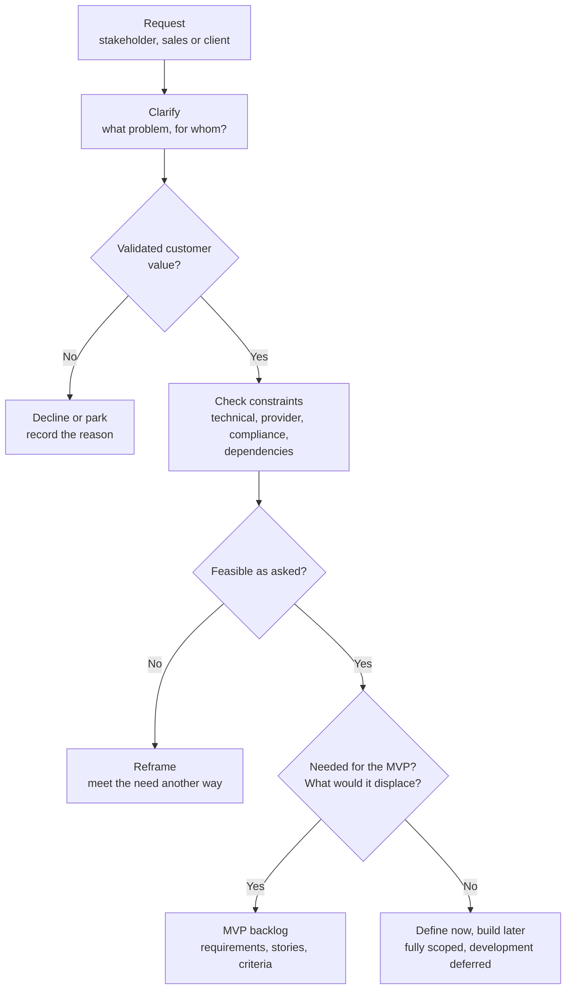

# Request Triage: New Channels, AI Ideas and Client Promises

**How requests were kept from becoming scope by default, without simply saying no.**

During development, new requests arrived constantly from stakeholders and sales: another channel, an AI capability, a client-specific promise. Some came with a clear business case. Others came with only "a client was told we'd have this." Treating every request as a feature would have made the MVP unbounded. Refusing them would have thrown away real signals.

*The framework below is a portfolio reconstruction of how requests were evaluated. The worked examples and their outcomes are real; names and details are generalized.*

## The flow

## The questions every request answered

1. What problem is it actually solving?
2. Who needs it, and how many customers share the need?
3. What value does it create?
4. Is it required for the MVP to be usable?
5. What does it depend on, inside the platform and at providers?
6. What technical, policy or compliance constraints apply?
7. Could an existing capability meet the underlying need?
8. What would we stop doing if we accepted it now?

## Worked example 1: a new channel mid-build

**Request.** Voice, raised while SMS was still the core focus.

**Evaluation.** Voice isn't one feature. It is a family of capabilities, each with its own provider dependencies, setup flow and compliance surface:

- text-to-speech messages
- interactive voice menus
- conferencing
- SIP trunking
- number masking

Adding it mid-build would have split engineering attention across a second complex channel before the first was finished.

**Outcome: defined now, built later.** The capabilities were mapped and described in product terms, and development was scheduled for later. The MVP kept its focus, and the work was ready when Voice was prioritized.

## Worked example 2: AI requests

**Request.** Several AI capabilities, some ambitious and beyond what established CPaaS providers offered.

**Evaluation.** The question wasn't "can we add AI?" but "what problem does this solve, and does it need AI?" Mapping each request to its underlying problem showed a pattern: **every AI request was an alternative way into a capability that first had to exist without AI.**

| AI request | Underlying problem | Non-AI foundation it depends on | AI's role |
|---|---|---|---|
| Generate a segment with AI | Writing segment rules is hard for non-technical users | Rule-based static and dynamic segments | Suggest rules; the user reviews and saves |
| Create a campaign from a prompt | Campaign setup takes many steps | The campaign builder | Suggest content, audience and timing |
| Message and tone generator | Writing good copy for each channel is slow | Channel templates | Draft copy within the channel's constraints |
| Report from a prompt | Building reports with filters is tedious | A condition-based report builder | Describe the report instead of configuring it |
| Command bar for first sends | New users don't know where to start | Guided onboarding and the activation checklist | A shortcut to the first message |
| Anomaly detection and spend forecasting | Unusual traffic or cost spikes go unnoticed | Logs, spend data and threshold alerts | Predict and flag what thresholds would miss |

**Outcome: defined now, built later.** We decided to build the platform's basics first and scale into advanced features after. The deferral applied only to development. In product and scope terms, each AI capability was fully defined, with its problem, its foundation and the user's role, so it was ready to build as the platform matured. Each one also depended on the capability beneath it, which made basics first the natural order.

All six sat in the product areas I owned. Where AI was defined, the user stayed in control: the AI suggests a segment or drafts copy, and the user decides.

## Worked example 3: a channel that couldn't be a channel

**Request.** A popular social platform, proposed as a messaging channel.

**Evaluation.** Investigation showed the platform doesn't support business messaging the way the product would need. What it can provide is leads from ads.

**Outcome: reframed.** The underlying need, reaching the audience on that platform, was met in a different shape: as a lead source feeding audiences and campaigns, not as a send channel.

## Four outcomes, not two

| Outcome | When | What it avoids |
|---|---|---|
| **MVP backlog** | Validated, feasible and needed now | — |
| **Define now, build later** | Validated, but not needed for the MVP: fully scoped now, development scheduled later | Losing the idea, or rushing it into scope |
| **Reframe** | The need is real but the request isn't feasible as asked | Building the wrong thing, or rejecting a real need |
| **Decline or park** | No validated value | Scope driven by promises alone |

The middle two matter most. Most requests aren't wrong; they're early, or shaped wrongly. A triage that only says yes or no forces the team into either scope creep or lost signals.
