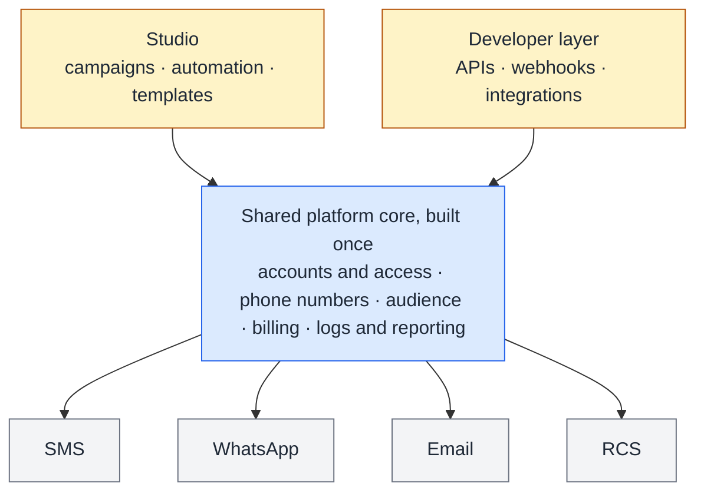

# B2B CPaaS Platform

**Taking a stalled communications-platform initiative from a pile of channel integrations to a defined product and a delivered MVP.**

**Role:** Product Manager / Product Owner (one of three PMs)
**Stage:** MVP delivered with pilot clients, then handed off. The product continued to evolve after my involvement.
**Focus:** Product definition · MVP scoping · Scope management · Technical product management · Cross-functional delivery

---

## The problem

Businesses that send messages across several channels usually integrate with each provider separately. Each integration has its own API, authentication, compliance rules, delivery states, billing and reporting. A CPaaS platform puts all of that behind one platform and one API.

When I joined, the initiative had been running for a long time without producing a product. There was no defined product and no established platform foundation: just a few channels wired into an interface that was buggy and had no coherent UX. Patching it would have produced a polished pile of integrations, not a platform.

## What we did

We reset and started from scratch. Instead of a list of channels, the product was redefined as a platform:

Gray: channels. Blue: the shared core. Amber: the layers that use it. Each channel keeps its own rules: sender identity, templates, delivery states and compliance. Everything a business needs regardless of channel lives once, in the core. Campaigns and automation sit on top and can use any channel.

*This is a conceptual product model, not the internal technical architecture.*

## My role

I worked across the full lifecycle with two other PMs and with dedicated design, engineering and QA teams. My work included:

- product discovery and stakeholder and sales requirements
- MVP definition and prioritization
- requirements, user stories and acceptance criteria
- UX direction and design review
- engineering collaboration
- product acceptance with QA
- demos and pilot-client discussions

**What I owned directly:** the product definition of 50 of the platform's 120 epics, across eight of its seventeen product areas:

- Registration and Onboarding
- Dashboard and Analytics
- Audience
- Studio (campaigns, automation and templates)
- Logs and Reporting
- Support
- Settings and Integrations
- Billing (shared with another PM)

**Cross-team work:** many engineers were new to CPaaS. I helped the team understand channel behavior, delivery states, routing and fallback, compliance and pricing well enough to build the right behavior. That gap was one of the project's main bottlenecks and added significant time to the plan. I didn't build the telecom infrastructure, the APIs or the provider integrations.

## Key decisions

1. **Reset rather than repair.** With no product definition and an unstable base, incremental fixes would have locked in the wrong structure.
2. **A platform, not a channel collection.** Shared capabilities are built once. Channels plug into them with their own rules.
3. **A layered MVP.** First the platform foundations, then each channel's essentials, then operations (billing, numbers, logs). Advanced capabilities came last and were kept small.
4. **Every request is a hypothesis.** New channels, AI ideas and client promises went through the same triage: what problem it solves, who needs it, what it depends on, and what it would displace.
5. **Define now, build later.** AI and new-channel requests weren't refused. They were fully defined in product and scope terms, and only their development was deferred. The MVP stayed focused on platform basics, and the advanced features were ready to build next.

## Outcome

- An MVP covering:
  - SMS, WhatsApp, Email and RCS
  - onboarding and audience management (contacts and segments)
  - number management
  - billing
  - APIs
  - initial campaigns and automation
- Pilot clients and sales demonstrations.
- A full product map: 17 areas, 120 epics, each tracked through definition status. The continuing team used it as their foundation.

## Explore

- [`Docs/01-from-reset-to-mvp.md`](Docs/01-from-reset-to-mvp.md): the reset, the platform model, MVP layering, and the work across teams.
- [`Docs/request-triage.md`](Docs/request-triage.md): how channel, AI and client requests were evaluated, with worked examples.
- [`Prototype`](https://mebi-kell.github.io/product-management-portfolio/CPaaS/Prototype/Qova%20v2.dc.html): an interactive walkthrough of the platform. It is a portfolio reconstruction with synthetic data.

---

*Company, product, customer, vendor and individual names are omitted. Diagrams are conceptual. No internal architecture, pricing or commercial terms are disclosed.*
