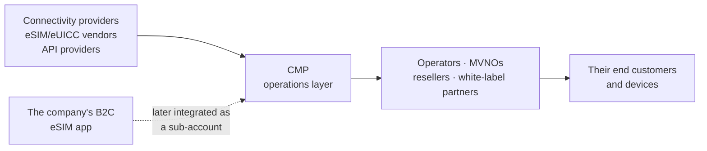

# From Concept to a Commercial B2B Platform

**How a new connectivity management product was defined, delivered and taken to market, and what "Project Management Assistant" actually covered.**

## Context

The company sold eSIMs directly to consumers through a mobile app. CMP was a new, separate B2B product built from scratch. Its customers would be telecom operators, MVNOs, connectivity providers, resellers and white-label partners who need to operate connectivity for their own customers or devices.

My formal title was Project Management Assistant. I worked across product, engineering, design, marketing, vendors and clients, alongside the CPO, CTO, designers and the marketing lead.

## Understanding the ecosystem first

CMP sits in the middle of a chain it doesn't fully control:

Before features could be defined, the product needed clear answers to three questions. What do the vendors actually expose through their APIs? What do B2B customers need to operate day to day? Where does CMP's responsibility start and stop?

The last one produced the first real product decision: **provisioning stays out of scope.** CMP manages a SIM's life after it exists: activate, assign, monitor, suspend, resume, deactivate, retire. Creating eSIM profiles was left to the vendor layer at this stage. That boundary decided which integrations mattered and kept the first phase achievable.

## Discovery from outside the building

Requirements came from more directions than internal planning:

- **Vendors.** In meetings with connectivity providers, eSIM vendors and API providers, I documented capabilities, asked the clarifying questions, and identified integration constraints. Then I translated "what the vendor can do" into "what the product can offer."
- **Prospective clients.** In sales meetings and demos, real B2B contexts surfaced requirements nobody had planned for. One example: a prospective client in Nigeria explored a white-label version of CMP for airport connectivity. It's a good example of requirements arriving from a real business context instead of from internal planning.
- **The market.** I benchmarked eSIM management workflows, connectivity-management experiences, APIs, UX patterns and relevant policies. Major operators such as Telefónica, Vodafone and AT&T were among the players we monitored.

## Product complexity

CMP wasn't an eSIM storefront. The hard parts were structural:

| Complexity | What it meant for the product |
|---|---|
| **Multi-tenancy** | A parent account with reseller and white-label sub-accounts, each holding its own SIMs, plans and quotas. See the [account model](account-model.md). |
| **Permissions** | Custom roles, with users assigned both a role and an account. A permission only means something in relation to the account it applies to. |
| **Connectivity abstraction** | Plans built from zones (countries and regions, grouped), operator restrictions, data allowances and expiry rules, so one plan model could work across providers. |
| **White-labeling** | Sub-accounts carry their own logo, domain and colors. Later, auto white-labeling applied branding without manual setup. |
| **External dependencies** | What vendors' APIs exposed limited what CMP could offer, so vendor capability had to be checked before anything was promised. |

## From requirements to delivery

The work followed one consistent path: input from stakeholders, vendors or clients → evaluation → feature definition → requirements → user stories and acceptance criteria → UX requirements → design review → development coordination → readiness.

Each feature was tracked separately for design readiness, PRD/user-story readiness and acceptance-criteria readiness, alongside development and QA status. The core modules (SIM management, plans and zones, sub-accounts, users and roles) were completed and marked fully ready during the first phase.

**Example of a requirement.** *This is reconstructed and illustrative, not copied from internal documents.*

> **Story:** As an operator admin, I can suspend many SIMs at once so I can respond quickly to a contract or fraud issue.
>
> **Acceptance criteria**
> - Only SIMs in a state that allows suspension are actioned. Others are skipped, with the reason shown.
> - Results are reported per SIM, so a partial failure doesn't hide which SIMs succeeded.
> - Repeating the request doesn't double-apply the operation.
> - A user can only action SIMs in accounts their role covers.
> - Every operation records who did it, when, and the outcome.

### Delivery decisions I made

- **Re-QA after an infrastructure change.** Engineering replaced the database to improve reliability. I moved modules that had already passed back to "QA in progress." The code hadn't changed, but what it ran on had, so earlier test results no longer counted.
- **Keep multi-provider support out of the launch.** It was in progress, but it wasn't part of that phase's launch scope, so it wasn't counted as launch work.
- **Freeze CMP-hosted plan and zone management.** Its backend was in progress and its acceptance criteria weren't final, so I froze it for the next phase rather than let it hold up the release.

All of this ran alongside improvements to the B2C app and the full definition of CMP Retail.

## CMP Retail: defining a middle tier

Not every B2B customer fits "reseller" or "operator." Businesses such as **travel agencies** want to offer connectivity under their own brand. They need more than reselling someone else's product, but much less than running the full lifecycle platform.

I defined **CMP Retail** for that gap, both product definition and scope, on my own:

| | Reselling | **CMP Retail** | Full CMP |
|---|---|---|---|
| Who it's for | Partners reselling connectivity | Businesses such as travel agencies offering connectivity under their own brand | Operators, MVNOs and connectivity providers |
| Depth | Resale | More than resale, less than full lifecycle operations | Full SIM, plan, account and user operations |

The point was packaging. A tier that's too thin is just a reseller program, and one that's too thick hands non-telecom businesses an operations console they don't need. Deciding where that line sits is product definition, even before any feature exists.

## Connecting the roadmap to the market

CMP was new, so marketing first had to understand what it was. I worked with the marketing team to:

- **explain** the product, its functionality, the roadmap and the value proposition
- **define** positioning, ideal customer profiles and customer types
- **decide** product messaging. Those messaging decisions were mine.
- **align** marketing priorities with the roadmap, so each capability got attention when it was actually shipping
- **shape** launch considerations, marketing KPIs (acquisition, conversion, product interest) and sales enablement: presentations, demos, website copy

## Outcome

- CMP was commercialized as a B2B product.
- The core modules were delivered in the first phase. Later phases added refactors, auto white-labeling, CMP-hosted plans and zones, B2C app integration and a B2C admin panel.
- CMP Retail was fully defined as a new product tier.

## What I learned

- **Say out loud what you don't do.** "We don't handle provisioning" sounds like a limitation, but it was one of the most useful decisions. CMP works on SIMs whose profiles already exist and only operates them through the providers' APIs. That made the integration surface much smaller and kept the first phase deliverable.
- **Multi-tenancy is a permissions problem before it's a UI problem.** A role like "can suspend SIMs" means nothing until you know *which account's* SIMs. Assigning users both a role and an account was what made reseller and white-label structures safe, and every bulk action had to respect that scope.
- **Packaging is product work.** CMP Retail was as much about what to leave out as what to put in. Its core was a decision about where to draw the line between reselling and operating, and getting that line right for travel agencies mattered more than any single feature.
- **Infrastructure changes reset your confidence.** Swapping the database didn't change a line of feature code, but it made every earlier QA result out of date. A status column should show what you can still vouch for, not what was finished at some point.
- **If marketing can't explain it, the roadmap isn't finished.** Translating modules into positioning and messaging regularly showed which capabilities were actually ready to talk about and which only existed in planning.
