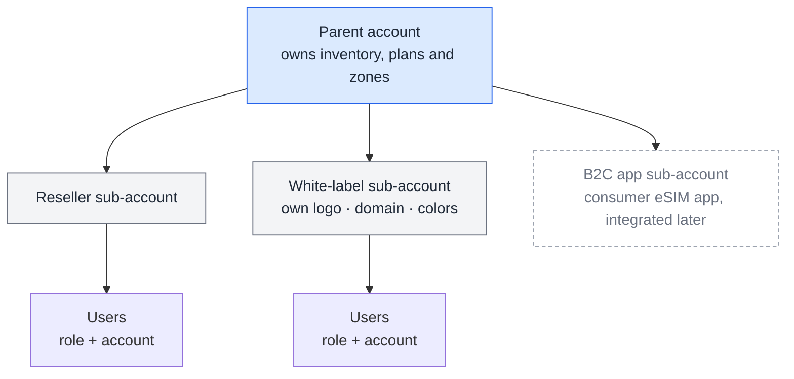

# The Account Model

**How one platform serves operators, resellers and white-label partners, each with their own SIMs, plans, quotas, branding and people.**

## The hierarchy

*Conceptual. It shows the product model, not the database or the internal architecture.*

## What each level controls

| Capability | Parent account | Sub-account (reseller or white-label) |
|---|---|---|
| SIM inventory | Holds the inventory | Receives SIMs assigned from the parent |
| Plans and zones | Defines zones (country/region groups, operator restrictions) and plans (data, operator, expiry) | Receives assigned plans |
| Quotas | Sets quotas per sub-account | Operates within its quota |
| Company profile | — | Name, address, logo, contact persons |
| Branding | — | Logo, domain and colors. Auto white-labeling applies these without manual setup (a later phase). |
| Users | Users are created and invited, each assigned a role *and* an account | Its users act within their account's scope |
| Roles | Custom roles with configurable permissions | Its users hold one of those roles |

## Why role + account, not role alone

In a multi-tenant product, "can suspend SIMs" is incomplete until you know *whose* SIMs. Pairing every user with both a role and an account is what keeps a reseller's admin out of another tenant's inventory. The same scoping has to apply to bulk operations, exports and dashboards.

## Product tiers

| | Reselling | **CMP Retail** | Full CMP |
|---|---|---|---|
| For | Partners reselling connectivity | Businesses such as travel agencies offering connectivity under their own brand | Operators, MVNOs, connectivity providers |
| Depth | Resale | More than resale, less than full lifecycle operations | Full SIM, plan, account and user operations |
| My role | Requirements contributor | **Defined the product and its scope on my own** | Requirements contributor |

White-label branding and scoped sub-accounts already existed in the platform. For CMP Retail, the product question was how much of the operations layer a non-telecom business actually needs.

---

*Capabilities come from the feature planning sheet.*
