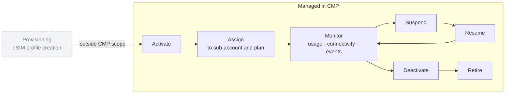

# CMP: Connectivity Management Platform

**A new B2B platform for operating eSIM connectivity at scale, across operators, resellers and white-label partners, taken from early concept to a commercial product.**

**Formal title:** Project Management Assistant
**Actual scope:** requirements, feature definition, user stories and acceptance criteria, UX requirements, vendor and client discovery, delivery coordination, product marketing
**Stage:** Commercialized, then developed in phases
**Focus:** B2B multi-tenancy · Lifecycle operations · Vendor and API translation · Product packaging · Product-to-market

---

## The problem

The company already sold eSIMs directly to consumers through a mobile app. The bigger opportunity was B2B: telecom operators, MVNOs, connectivity providers, resellers and white-label partners who need to *operate* connectivity, not just buy it. That means managing:

- SIM inventory
- plans and coverage zones
- sub-accounts and quotas
- users and permissions
- branding, across many organizations at once

CMP was built from scratch to be that operations layer.

## What it manages

*Conceptual lifecycle. Provisioning was deliberately outside the platform at this stage.*

Around that lifecycle sit five modules:

- **Dashboard:** usage, active SIMs and data consumption across accounts.
- **SIM Management:** inventory, details, signaling events, single and bulk operations, QR codes.
- **Plan Management:** zones, operator restrictions, data plans and expiry rules.
- **Sub-Account Management:** reseller and white-label structures with quotas and branding.
- **User Management:** custom roles and permissions.

A later B2C admin panel brought the consumer app's users, plans, promo codes and sales reporting into CMP.

## My role

My title was Project Management Assistant. The work went well beyond coordination:

- **Discovery:** gathered requirements from internal stakeholders, vendors, sales conversations and prospective clients.
- **Definition:** defined modules, features, business rules and edge cases, then wrote user stories and acceptance criteria for design and engineering.
- **Vendor translation:** worked with connectivity providers, eSIM/eUICC vendors and API providers to map what they could do onto what the product needed.
- **UX:** turned requirements into UX requirements and reviewed designs with the dedicated UI/UX and graphic designers.
- **Delivery:** tracked development and QA module by module, and made the scope and readiness calls described below.
- **Product marketing:** worked with marketing on positioning, ICP, messaging, launch strategy, KPIs and sales materials.
- **CMP Retail:** defined this white-label offering for businesses such as travel agencies on my own, from product definition to scope.

I wasn't CMP's sole product owner. It was a team effort with product leadership, engineering, design and marketing.

## Key decisions

1. **Draw the lifecycle boundary.** CMP manages connectivity after provisioning, not provisioning itself.
2. **Design for many tenants from day one.** Reseller and white-label sub-accounts each have their own SIMs, plans, quotas, branding and users.
3. **Define a middle tier.** CMP Retail sits between reselling and running the full platform.
4. **Protect the launch phase.** Multi-provider support stayed out of the launch scope, and CMP-hosted plan and zone management was frozen for the next phase.
5. **Re-verify after infrastructure changes.** When engineering replaced the database, already-tested modules went back to QA.
6. **Connect the roadmap to the market.** Messaging and marketing priorities followed what was actually shipping.

## Outcome

- Commercialized as a B2B product.
- Core modules (SIM management, plans and zones, sub-accounts, users and roles) were completed and marked fully ready during the first phase.
- Later phases added refactors, auto white-labeling, CMP-hosted plans and zones, B2C app integration and a B2C admin panel.

## Explore

- [`Docs/01-from-concept-to-commercial-platform.md`](Docs/01-from-concept-to-commercial-platform.md): discovery, the requirements behind the delivery decisions, CMP Retail, and the product-to-market bridge.
- [`Docs/account-model.md`](Docs/account-model.md): the multi-tenant account model and the product tiers.
- [`Prototype`](https://mebi-kell.github.io/product-management-portfolio/Connectivity%20Management%20Platform/Prototype/CMP%20Console.dc.html): an interactive walkthrough of the console. It is a portfolio reconstruction with synthetic data.

---

*Company, client and vendor names are omitted. Diagrams are conceptual and don't describe the internal architecture.*
