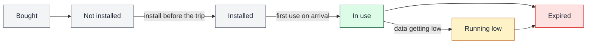

# eSIM Lifecycle Map

**Each stage of the traveler's journey: the question they're asking, what is actually happening, where it goes wrong, and how the product responds.**

## The states a user sees

*Conceptual. One primary state per eSIM, always.*

## Stage by stage

| Stage | The user's question | What's actually happening | Where it goes wrong | Product response |
|---|---|---|---|---|
| **Discover and onboard** | "Will this work for my trip and my phone?" | Nothing yet | The user buys for an incompatible or locked phone | Compatibility check (eSIM-capable, carrier-unlocked) before purchase |
| **Choose a package** | "What do I need for these countries?" | Catalogue lookup | A multi-country trip gets patched together with single-country plans | Search by destination; regional packages (such as Balkans and Europe) with full coverage shown before purchase |
| **Pay** | "Did my payment go through?" | The payment may be processing, need 3-D Secure, succeed or fail | The app shows success before the provider confirms; a retry double-charges | Explicit payment states; success and eSIM delivery only after the provider's server-side confirmation; one idempotency key per order |
| **Receive** | "Where's my eSIM?" | The eSIM is issued after payment is confirmed | Payment is taken but delivery fails | "Payment received, preparing your eSIM," with automatic retry and a support path |
| **Assign** | "Which one is for whom?" | One buyer, several eSIMs, possibly for several people | eSIMs get mixed up, or shared with the wrong person | An owner label on every eSIM; installation hand-off per eSIM through the share sheet |
| **Install** | "How do I install it, and when?" | A profile download to the device | Installing without internet; deleting and reinstalling a single-use code; installing on the wrong device | Three install paths (one-tap, QR, manual); "install on Wi-Fi before you fly"; single-use warning |
| **Installation feedback** | "Did it work? What now?" | Installation succeeds or fails, for a specific reason | Technical errors with no next step | Every message: what happened · what it means · what to do next, plus a reference ID |
| **Use on arrival** | "Why isn't it working?" | The plan starts on first use | Wrong data line selected, or roaming off for the eSIM line | The success message tells the user to switch the data line and turn on data roaming on landing |
| **Monitor** | "How much do I have left?" | Usage reported by the provider | Usage is unclear, especially for eSIMs on other people's phones | Remaining data and validity per eSIM, from provider records, not the buyer's device |
| **Expire** | "What happens when it ends?" | The plan reaches its data or time limit | The connection drops with no explanation | A clear "Running low" state before the end, and an "Expired" state that explains what happened |

## How to read this map

The lifecycle was the foundation for both requirements and UX decisions. Each change is tied to a stage, to the question the user is asking at that stage, and to what goes wrong there.

---

*Problems by stage are confirmed. The product responses are a reconstruction of how the requirements worked, not copied from internal specs.*
