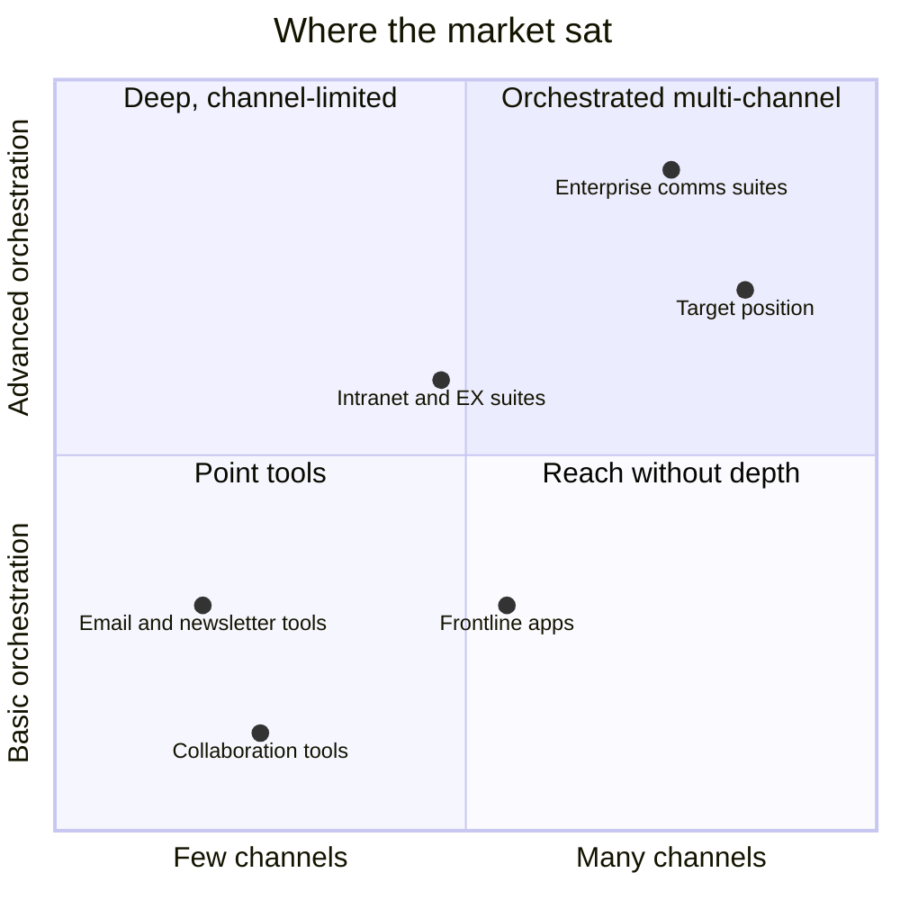

# Competitive Landscape

**Early desk research into how employee communication was being solved, and where an HR product built on top of a communications platform could fit.**

*This is my first-pass research, based on public information available at the time. Ratings are relative judgments on a 1–5 scale, not benchmarks. Competitor products change; treat this as a snapshot of the reasoning, not a current market report.*

## What I compared

Thirteen products across four types of solution, scored on ten dimensions:

- ease of use
- multi-channel support
- analytics
- automation and AI
- frontline readiness
- content tools
- engagement features
- customizability
- pricing flexibility
- enterprise fit

Later research also covered Haiilo and Culture Amp.

| Type | Examples | What they do well | Where they fall short for this problem |
|---|---|---|---|
| **Enterprise comms suites** | Staffbase, Poppulo, Firstup | Analytics, orchestration, enterprise depth, integrations | High cost and complexity; heavy onboarding; app- or email-centric delivery; limited WhatsApp/SMS out of the box |
| **Intranet and employee-experience suites** | Workvivo, Unily, Oak Engage, a regional all-in-one player | Social and culture features, polished intranet UX, mobile apps | Lighter on campaign management, outbound multi-channel delivery and automation; often IT-heavy to implement |
| **Frontline apps** | Blink | Mobile-first, built for deskless workers, fast onboarding | Little campaign planning or segmentation; basic analytics; less suited to office teams |
| **Collaboration and point tools** | Microsoft Teams, Slack, Outlook plugins, newsletter tools, legacy on-prem messaging | Already in place, familiar, cheap or bundled | Not built for targeted campaigns or measuring impact; email-only or desk-only reach |

## Where the market sat

*Approximate positions, derived from my scores: channel reach on the horizontal axis, and the average of analytics and automation on the vertical axis. The target position is what the product was designed toward, not a measured result.*

## What the research showed

1. **Depth and reach rarely came together.** The products with strong orchestration and analytics were the most complex and expensive, and they delivered mainly through their own app, intranet or email. The products that reached frontline workers well had little campaign planning or segmentation behind them.
2. **Most suites asked employees to come to them.** An app or intranet only works once employees adopt it, and that takes change management. Several products had weak SMS and WhatsApp support out of the box, which are the channels deskless employees already use.
3. **Collaboration tools aren't campaign tools.** Teams and Slack are everywhere and essentially free inside existing bundles. They aren't built for targeting, scheduling or measuring internal comms, so they work better as channels to deliver through than as competitors.
4. **Point tools proved demand but capped value.** Email plugins and newsletter tools showed comms teams will pay for measurement and better content, but they stop at one channel.
5. **Pricing mostly meant talking to sales.** Most enterprise suites were quote-based and high-touch, with no self-serve tier. Only frontline and collaboration tools published simple tiers.

## Where the research shows up in the product

| Research finding | Product response |
|---|---|
| Reach and orchestration rarely came together | Campaigns, automation, segments and engagement analytics in one place, delivered through the CPaaS backbone |
| Deskless employees aren't reachable through apps or email alone | SMS and WhatsApp as first-class MVP channels, with the employee portal deferred to later stages |
| Teams and Slack are channels, not rivals | Slack and Teams planned as delivery channels in the final stage (MLP) |
| Suites are heavy to set up | Managed channel setup by default, with templates and quick-start segments |
| Enterprise pricing is opaque and high-touch | Billing designed around both a platform-fee model and a tiered model |

The target position wasn't "beat the enterprise suites on depth." It was **orchestrated, measurable HR communication that reaches every employee on channels they already use**, without the cost and implementation weight of a full intranet suite.

---

*Competitor names refer to public products. Pricing figures from the original research are left out, because they were estimates and change over time.*
