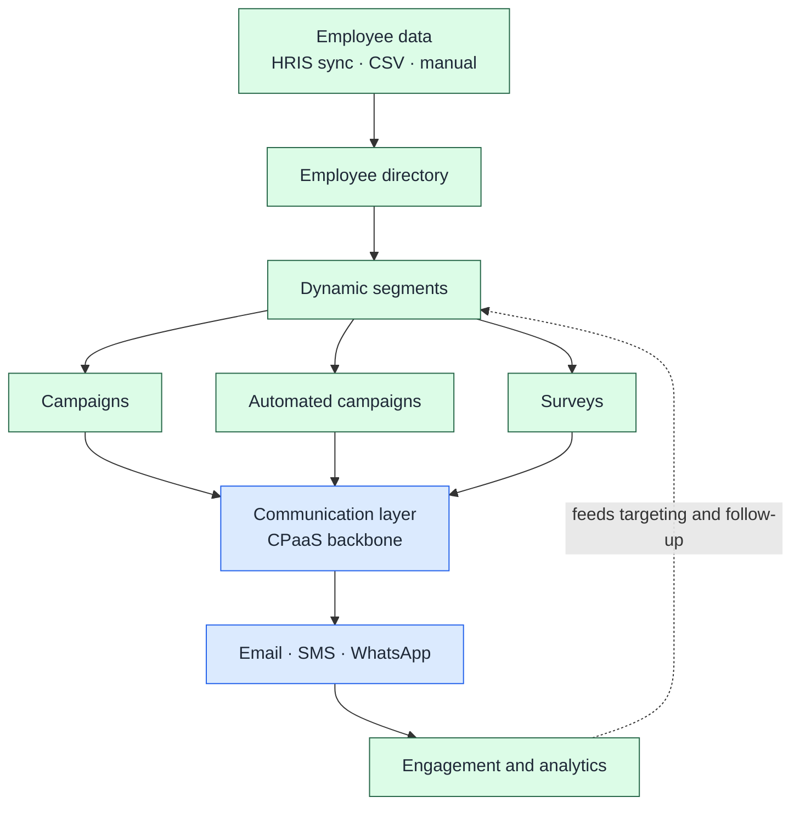

# Employee Communications & Engagement Platform

**Turning communications infrastructure into a product HR teams can actually use.**

**Role:** Product Manager / Product Builder
**Stage:** MVP fully defined and designed, with a working prototype. Development was waiting on engineering resources when I left.
**Focus:** Product discovery · Vertical product strategy · Abstraction of technical complexity · Segmentation and automation design · MVP/MMP/MLP planning

---

## The problem

HR and People teams need to reach every employee: office staff, field teams and frontline workers. They also need to know whether the message landed. In practice they juggle email lists, spreadsheets and ad hoc messages, with no shared audience model and no way to measure engagement.

Communications infrastructure (CPaaS) can deliver the messages. But it speaks in providers, APIs, recipients and delivery states. An HR manager thinks in employees, departments, lifecycle events and whether people engaged.

## What it is

A vertical HR product built on top of a horizontal communications platform: the CPaaS described in my [other case study](../CPaaS/README.md). HR works with business concepts, and the platform handles the delivery underneath.

Green is what HR sees and controls. Blue is the infrastructure the product hides.

## My role

I owned the product end to end, apart from visual design execution, which a dedicated designer handled:

- discovery with HR professionals and potential customers
- market and competitor research
- product strategy and redefinition
- requirements, user stories and acceptance criteria
- MVP / MMP / MLP planning
- UX direction and design review
- managing the dependency on the CPaaS platform

## What I delivered

- **A fully defined product:**
  - 229 functions across 12 epics
  - 203 with the concept fully defined
  - 140 with PRDs and acceptance criteria ready
- **A designed and prototyped MVP,** with a working prototype.
- **Staged scope:**
  - 89 functions in the MVP, 120 in the MMP, 20 in the MLP.
  - Planned to get to a working, promotable product first, with two close follow-up milestones.
- **A reuse model with the CPaaS platform.** Authentication, account security and the messaging backbone were reused, not rebuilt.

## Key decisions

1. **Revalidate, don't preserve.** The original concept, essentially a simplified CPaaS for HR managers, was treated as a hypothesis and tested against current HR workflows. It became a campaign, automation and engagement product.
2. **Hide the infrastructure.** Channel setup defaults to a managed path, so HR never has to understand providers. Expert users can still bring their own provider.
3. **Treat the HRIS as the source of truth.** HRIS-synced employee records are locked and edited at the source, and every record shows where it came from.
4. **Rules, not lists.** Audiences are rules the platform maintains. Auto-join rules keep segments current without manual upkeep.
5. **Follow up on engagement, not just delivery.** A campaign can resend through another channel if a message is unread after a set time, not only when delivery fails.
6. **Put AI inside the workflow, and gate it until it's measurable.** The standalone AI module was dissolved into the steps where it helps. AI segmentation stayed behind a beta gate until its quality could be measured.

## Explore

- [`Docs/01-infrastructure-to-hr-product.md`](Docs/01-infrastructure-to-hr-product.md): revalidating the hypothesis, abstracting the infrastructure, and designing under a dependency.
- [`Docs/definition-evolution.md`](Docs/definition-evolution.md): how the product definition matured across three backlog versions.
- [`Docs/competitive-landscape.md`](Docs/competitive-landscape.md): thirteen products compared, where the market sat, and how the findings shaped the product.
- [`Prototype`](https://mebi-kell.github.io/product-management-portfolio/Employee%20Communications%20%26%20Engagement%20Platform/Prototype/Employee%20Communications%20%26%20Engagement%20Platform%20v3.dc.html): an interactive walkthrough of the product. It is a portfolio reconstruction with synthetic data.

---

*Company, product, customer and individual names are omitted. Diagrams are conceptual.*
